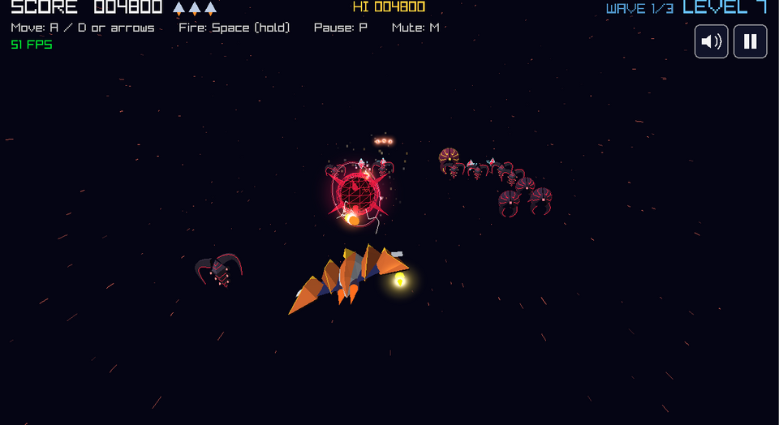
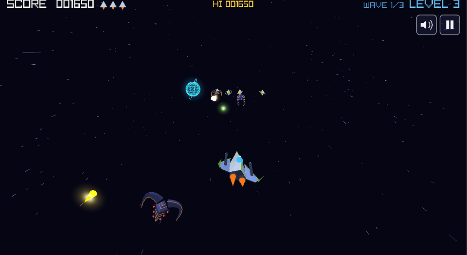
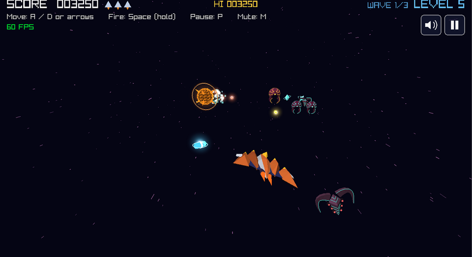
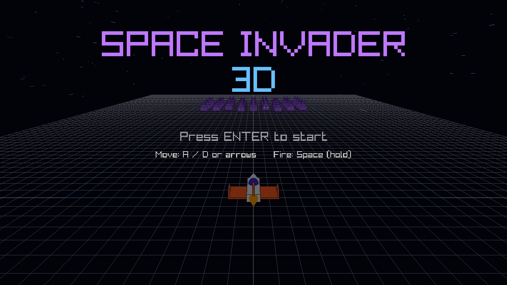
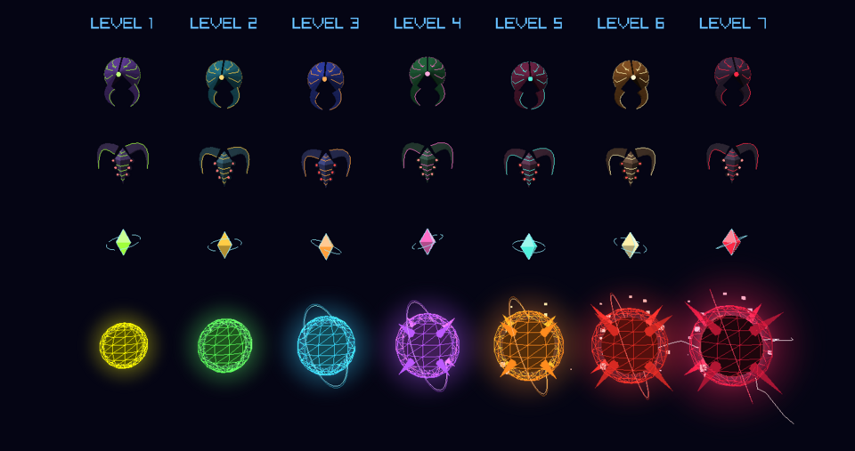
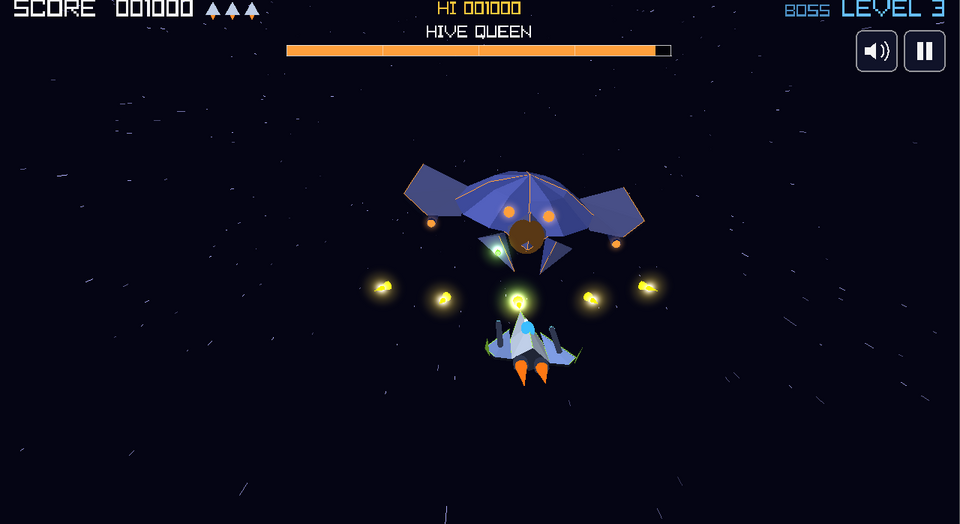
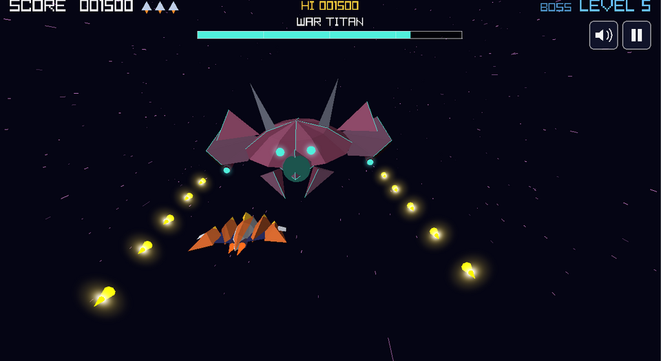
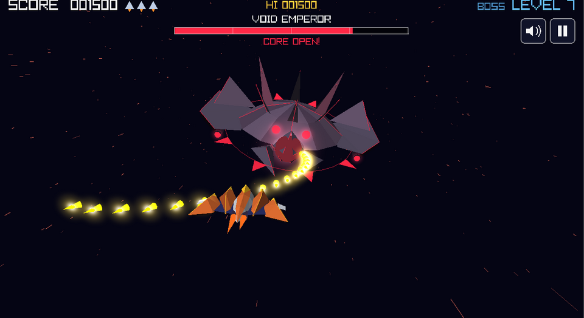
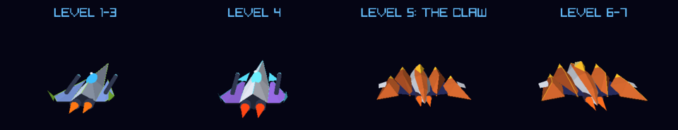

# Space Invader 3D

**[▶ Play the free demo in your browser](https://faridberlin.github.io/Space-Invader-3D/)** (levels 1-3; keyboard, mouse or touch screen).
The full game with all 7 levels is coming to Google Play.

A 3D remake of my 2D browser game *Space Dash Invaders*, written in **C++17** with
[raylib](https://www.raylib.com/). It is also a learning project: the goal is to understand C++ and how
real-time 3D graphics work, built one small, reviewed step at a time.



| | |
|---|---|
|  |  |
|  |  |

The three bosses: the **Hive Queen** (level 3), the **War Titan** (level 5) and the **Void Emperor** (level 7):

| | | |
|---|---|---|
|  |  |  |

Your ship through the levels:



## Play

| Platform | How |
|---|---|
| **Web (free demo)** | Open the link above. Click the game once so it gets the keyboard. |
| **Windows / Linux (free demo)** | Download the latest zip / tar.gz from [Releases](../../releases), unpack it and start `space-invader-3d`. |
| **Android (full game)** | Coming soon to Google Play. |

The demo contains levels 1 to 3 and the first boss. The full game adds levels 4 to 7, the Claw ship, the War Titan
and the Void Emperor.

**Touch / mouse:** drag anywhere to move, the ship fires by itself while your finger (or the mouse button) is down; tap to start; the pause and sound buttons sit at the top right (a muted game stays muted next time). The game also pauses itself when you switch to another app or window.

**Keyboard:** `A`/`D` or arrow keys to move, `Space` to shoot (hold for rapid fire), `Enter` to start / restart, `P` to pause, `M` to mute, `F3` to show the FPS. On desktop also `F` for fullscreen, `1`-`5` to pick the window size (you can drag the window edges too) and `Esc` to leave fullscreen or quit.

## The game

- Waves of invaders sweep sideways and step toward you. Shoot them before they reach you. They shoot back.
- Four alien types: **Scarabs** (100), **Reapers** (200, shoot more often), crystal **Drones** (150) and
  **Commanders** (500, three hits). Every few seconds one alien **dives** at you in an S-curve.
- **3 lives** (up to 5), and your **high score** is saved (on desktop and in the browser).
- Shot aliens sometimes drop a **power-up**: a **shield** that absorbs one hit, **rapid fire**, or rarely an **extra life**.
- Your ship **upgrades** as you go: two rockets per shot from level 4, and from level 5 you fly the
  **Claw**, a copper ship with claw-shaped wings, which fires three rockets from level 6.
- **Combos** multiply your points (up to x4) for quick kills in a row, and a fast wave without losing a ship
  earns a **wave-clear bonus**. Big hits and explosions shake the screen.
- A glowing **bomb** flies in every few seconds. Shoot it for **+500** points, or dodge it. Every level
  has its own bomb: from a calm yellow ball in level 1 to a cracked, crimson one with lightning in level 7.
- **Boss fights** at the end of levels 3, 5 and 7: the **Hive Queen**, the **War Titan** and the
  **Void Emperor**, each with a health bar, its own attack patterns and a core that opens for triple damage.
- **7 levels of 3 waves each.** Every level adds something new (Drones, divers, Reapers, Commanders, ship upgrades),
  gets faster and has its own colours: the aliens, the bombs and the stars change with every level.
  After level 7: a bonus and endless bonus waves.
- Particle explosions, a streaming starfield over a drifting **nebula** in each level's colours, glowing
  projectiles (both are custom GLSL shaders), sound effects and
  chiptune **music**: a calm menu track, a level track and a boss track that fade into each other.

## Building (for development)

This is how the game is built while working on it. (Publishing your own builds is not allowed, see [License](#license).)
You need a C++17 compiler, CMake and Git. On Linux also a few development libraries (see [`docs/SETUP.md`](docs/SETUP.md)).

```bash
cmake -B build
cmake --build build
./build/space-invader-3d
```

The first run downloads raylib automatically. The web version needs Emscripten, see [`docs/WEB.md`](docs/WEB.md).
Add `-DSPACE_INVADER_DEMO=ON` to the first command to build the demo (levels 1-3), as the web version and the
downloads are built.

## Tech stack

| Part | Choice |
|---|---|
| Language | C++17 |
| Graphics / audio / input | raylib 5.5 (OpenGL 3.3 on desktop, WebGL 1 in the browser) |
| Build | CMake |
| Web build | Emscripten (WebAssembly) |
| CI / hosting | GitHub Actions, GitHub Pages and Releases |
| Android | planned (NDK, touch controls) |

## Documentation

- [`docs/DESIGN.md`](docs/DESIGN.md): gameplay rules, numbers ported from the 2D game, 3D design decisions
- [`docs/ARCHITECTURE.md`](docs/ARCHITECTURE.md): code structure and the cross-platform rules we follow
- [`docs/ROADMAP.md`](docs/ROADMAP.md): milestones with checkboxes
- [`docs/SETUP.md`](docs/SETUP.md): tools, building, publishing releases
- [`docs/WEB.md`](docs/WEB.md): building and testing the web version

## Project layout

```
space-invader-3d/
  CMakeLists.txt
  src/                 C++ source (Game, Player, InvaderGrid, Bomb, Audio, GlowRenderer, ...)
  assets/audio/        sound effects
  web/shell.html       the page around the browser build
  docs/                documentation and screenshots
  .github/workflows/   automatic builds, web deploy, releases
```

## Credits

- Built with [raylib](https://www.raylib.com/) (zlib license).
- Sound effects from the original 2D game.
- Music (all CC0, from [OpenGameArt](https://opengameart.org/)): "8-bit Epic Space Shooter Music" by **HydroGene**,
  "Boss Fight" from Chiptune Adventures by **Juhani Junkala**, and "Observing The Star" by **yd**.
  Details in [`assets/audio/README.md`](assets/audio/README.md).

## License

**All rights reserved.** You may read the code and learn from it, and play the game through the official links,
but you may not copy, modify, publish or sell it, or release your own builds (for example on an app store),
without permission. See [`LICENSE`](LICENSE). Third-party parts (raylib, the CC0 music) keep their own licences.
